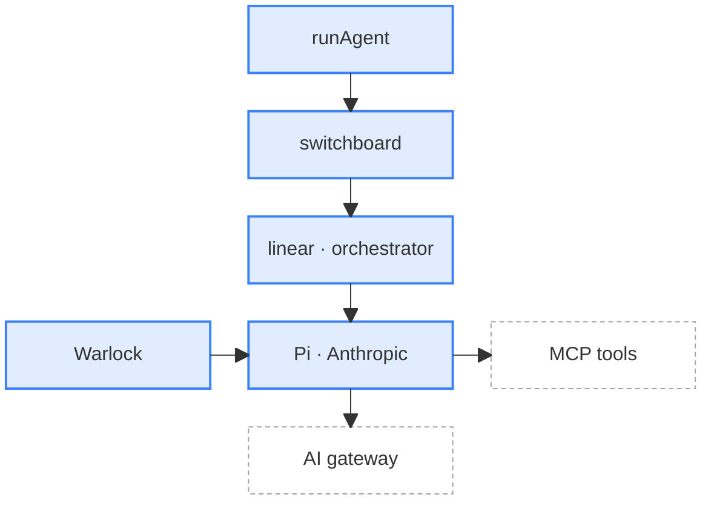

The wizard is built in layers. Each layer only calls the layer below it, and the compiler enforces that.

1. **The CLI layer** reads the command and starts a host.
2. **The host layer** shows a run. The TUI draws it in the terminal, and the headless runner logs it.
3. **The program layer** decides what to run, how many agents to spawn, and what each one gets. Its session store holds the state of a run.
4. **The agent layer** runs AI work against the user's code. It has no opinion about what runs, and never sees the UI or the store.

<svg viewBox="-2 -2 688 716" width="100%" role="img" aria-label="Wizard layers: CLI, hosts, programs, agent, harnesses">
<defs><marker id="wizard-arch-arrow" viewBox="0 0 10 10" refX="9" refY="5" markerWidth="7" markerHeight="7" orient="auto-start-reverse"><path d="M 0 0 L 10 5 L 0 10 z" fill="currentColor" fillOpacity="0.7" /></marker></defs>
<rect x="0" y="0" width="684" height="26" rx="3" fill="rgba(156,163,175,0.25)" stroke="none" />
<text x="342.0" y="13.0" textAnchor="middle" dominantBaseline="central" fill="currentColor" fontSize="12">src/cli</text>
<rect x="0" y="56" width="328" height="36" rx="3" fill="rgba(156,163,175,0.14)" stroke="#9ca3af" strokeWidth="2" />
<text x="164.0" y="74.0" textAnchor="middle" dominantBaseline="central" fill="currentColor" fontSize="12" fontFamily="ui-monospace, monospace">runCli</text>
<rect x="0" y="122" width="684" height="26" rx="3" fill="rgba(168,85,247,0.25)" stroke="none" />
<text x="342.0" y="135.0" textAnchor="middle" dominantBaseline="central" fill="currentColor" fontSize="12">src/tui · src/headless</text>
<rect x="0" y="178" width="150" height="36" rx="3" fill="rgba(168,85,247,0.14)" stroke="#a855f7" strokeWidth="2" />
<text x="75.0" y="196.0" textAnchor="middle" dominantBaseline="central" fill="currentColor" fontSize="12" fontFamily="ui-monospace, monospace">runTui</text>
<rect x="178" y="178" width="150" height="36" rx="3" fill="rgba(168,85,247,0.14)" stroke="#a855f7" strokeWidth="2" />
<text x="253.0" y="196.0" textAnchor="middle" dominantBaseline="central" fill="currentColor" fontSize="12" fontFamily="ui-monospace, monospace">runHeadless</text>
<rect x="356" y="178" width="150" height="36" rx="3" fill="rgba(168,85,247,0.14)" stroke="#a855f7" strokeWidth="2" />
<text x="431.0" y="196.0" textAnchor="middle" dominantBaseline="central" fill="currentColor" fontSize="12" fontFamily="ui-monospace, monospace">screens · logs</text>
<rect x="534" y="178" width="150" height="36" rx="3" fill="rgba(168,85,247,0.14)" stroke="#a855f7" strokeWidth="2" />
<text x="609.0" y="196.0" textAnchor="middle" dominantBaseline="central" fill="currentColor" fontSize="12" fontFamily="ui-monospace, monospace">WizardAsk</text>
<rect x="0" y="244" width="684" height="26" rx="3" fill="rgba(34,197,94,0.25)" stroke="none" />
<text x="342.0" y="257.0" textAnchor="middle" dominantBaseline="central" fill="currentColor" fontSize="12">src/programs</text>
<rect x="0" y="300" width="328" height="36" rx="3" fill="rgba(34,197,94,0.14)" stroke="#22c55e" strokeWidth="2" />
<text x="164.0" y="318.0" textAnchor="middle" dominantBaseline="central" fill="currentColor" fontSize="12" fontFamily="ui-monospace, monospace">runProgram</text>
<rect x="356" y="300" width="150" height="36" rx="3" fill="rgba(34,197,94,0.14)" stroke="#22c55e" strokeWidth="2" />
<text x="431.0" y="318.0" textAnchor="middle" dominantBaseline="central" fill="currentColor" fontSize="12" fontFamily="ui-monospace, monospace">SessionStore</text>
<rect x="0" y="366" width="684" height="26" rx="3" fill="rgba(59,130,246,0.25)" stroke="none" />
<text x="342.0" y="379.0" textAnchor="middle" dominantBaseline="central" fill="currentColor" fontSize="12">src/agent</text>
<rect x="0" y="422" width="328" height="36" rx="3" fill="rgba(59,130,246,0.14)" stroke="#3b82f6" strokeWidth="2" />
<text x="164.0" y="440.0" textAnchor="middle" dominantBaseline="central" fill="currentColor" fontSize="12" fontFamily="ui-monospace, monospace">runAgent</text>
<rect x="356" y="422" width="150" height="36" rx="3" fill="rgba(59,130,246,0.14)" stroke="#3b82f6" strokeWidth="2" />
<text x="431.0" y="440.0" textAnchor="middle" dominantBaseline="central" fill="currentColor" fontSize="12" fontFamily="ui-monospace, monospace">AgentProgress</text>
<rect x="534" y="422" width="150" height="36" rx="3" fill="rgba(59,130,246,0.14)" stroke="#3b82f6" strokeWidth="2" />
<text x="609.0" y="440.0" textAnchor="middle" dominantBaseline="central" fill="currentColor" fontSize="12" fontFamily="ui-monospace, monospace">interaction.ask</text>
<rect x="0" y="488" width="328" height="36" rx="3" fill="rgba(59,130,246,0.14)" stroke="#3b82f6" strokeWidth="2" />
<text x="164.0" y="506.0" textAnchor="middle" dominantBaseline="central" fill="currentColor" fontSize="12" fontFamily="ui-monospace, monospace">switchboard</text>
<rect x="0" y="554" width="150" height="36" rx="3" fill="rgba(59,130,246,0.14)" stroke="#3b82f6" strokeWidth="2" />
<text x="75.0" y="572.0" textAnchor="middle" dominantBaseline="central" fill="currentColor" fontSize="12" fontFamily="ui-monospace, monospace">Pi harness</text>
<rect x="178" y="554" width="150" height="36" rx="3" fill="rgba(59,130,246,0.14)" stroke="#3b82f6" strokeWidth="2" />
<text x="253.0" y="572.0" textAnchor="middle" dominantBaseline="central" fill="currentColor" fontSize="12" fontFamily="ui-monospace, monospace">Anthropic harness</text>
<rect x="0" y="620" width="328" height="36" rx="3" fill="none" stroke="#9ca3af" strokeWidth="1.5" strokeDasharray="4 3" />
<text x="164.0" y="638.0" textAnchor="middle" dominantBaseline="central" fill="currentColor" fontSize="12" fontFamily="ui-monospace, monospace">gateway · MCP · skills</text>
<rect x="0" y="686" width="684" height="26" rx="3" fill="rgba(156,163,175,0.25)" stroke="#9ca3af" strokeDasharray="4 3" />
<text x="342.0" y="699.0" textAnchor="middle" dominantBaseline="central" fill="currentColor" fontSize="12">src/shared · src/env</text>
<path d="M 164.0 92 L 164.0 135.0 L 75.0 135.0 L 75.0 176" fill="none" stroke="currentColor" strokeOpacity="0.7" strokeWidth="1.5" markerEnd="url(#wizard-arch-arrow)" />
<path d="M 164.0 92 L 164.0 135.0 L 253.0 135.0 L 253.0 176" fill="none" stroke="currentColor" strokeOpacity="0.7" strokeWidth="1.5" markerEnd="url(#wizard-arch-arrow)" />
<path d="M 75.0 214 L 75.0 257.0 L 164.0 257.0 L 164.0 298" fill="none" stroke="currentColor" strokeOpacity="0.7" strokeWidth="1.5" markerEnd="url(#wizard-arch-arrow)" />
<path d="M 253.0 214 L 253.0 257.0 L 164.0 257.0 L 164.0 298" fill="none" stroke="currentColor" strokeOpacity="0.7" strokeWidth="1.5" markerEnd="url(#wizard-arch-arrow)" />
<path d="M 164.0 336 L 164.0 420" fill="none" stroke="currentColor" strokeOpacity="0.7" strokeWidth="1.5" markerEnd="url(#wizard-arch-arrow)" />
<path d="M 164.0 458 L 164.0 486" fill="none" stroke="currentColor" strokeOpacity="0.7" strokeWidth="1.5" markerEnd="url(#wizard-arch-arrow)" />
<path d="M 164.0 524 L 164.0 539.0 L 75.0 539.0 L 75.0 552" fill="none" stroke="currentColor" strokeOpacity="0.7" strokeWidth="1.5" markerEnd="url(#wizard-arch-arrow)" />
<path d="M 164.0 524 L 164.0 539.0 L 253.0 539.0 L 253.0 552" fill="none" stroke="currentColor" strokeOpacity="0.7" strokeWidth="1.5" markerEnd="url(#wizard-arch-arrow)" />
<path d="M 75.0 590 L 75.0 605.0 L 164.0 605.0 L 164.0 618" fill="none" stroke="currentColor" strokeOpacity="0.7" strokeWidth="1.5" markerEnd="url(#wizard-arch-arrow)" />
<path d="M 253.0 590 L 253.0 605.0 L 164.0 605.0 L 164.0 618" fill="none" stroke="currentColor" strokeOpacity="0.7" strokeWidth="1.5" markerEnd="url(#wizard-arch-arrow)" />
<path d="M 328 440.0 L 354 440.0" fill="none" stroke="currentColor" strokeOpacity="0.7" strokeWidth="1.5" strokeDasharray="3 3" markerEnd="url(#wizard-arch-arrow)" />
<path d="M 431.0 422 L 431.0 338" fill="none" stroke="currentColor" strokeOpacity="0.7" strokeWidth="1.5" strokeDasharray="3 3" markerEnd="url(#wizard-arch-arrow)" />
<text x="437.0" y="380.0" dominantBaseline="central" fill="currentColor" fillOpacity="0.7" fontSize="10" fontStyle="italic">optional</text>
<path d="M 431.0 300 L 431.0 216" fill="none" stroke="currentColor" strokeOpacity="0.7" strokeWidth="1.5" markerEnd="url(#wizard-arch-arrow)" />
<path d="M 609.0 422 L 609.0 216" fill="none" stroke="currentColor" strokeOpacity="0.7" strokeWidth="1.5" strokeDasharray="3 3" markerEnd="url(#wizard-arch-arrow)" />
<text x="615.0" y="319.0" dominantBaseline="central" fill="currentColor" fillOpacity="0.7" fontSize="10" fontStyle="italic">optional</text>
</svg>

The two left lanes are the calls going down, one per host. The third lane is progress coming back up into the store, and the right lane is a question for the user coming back up. Both are optional, so they're dotted: `runAgent` only sends progress through `onProgress` and questions through `interaction.ask` when the host passes them in. Each colour is one owner: grey for the CLI, purple for the hosts, green for programs and the store, and blue for the agent. The dashed box is outside the wizard repo: the AI gateway, the PostHog MCP server, and context mill skills. The bottom band is shared code every layer imports.

## The CLI layer

`runCli` in `src/cli` reads the command and its flags, then starts the right host. It's the only layer that imports both hosts, and the only place that calls `process.exit`.

## The host layer

A host builds a session store, starts a program with `runProgram`, and shows the result.

You can build a new host on the session store without changing any program.

### TUI

The TUI draws the run in the terminal. The screen is derived from the store's state, there's no manual navigation.

### Headless runner

The headless runner logs the run instead of drawing it. CI, the workbench, benchmarks, and cloud runs use it.

## The program layer

A program is a job with a purpose, like "set up error tracking". The program decides everything the agent doesn't:

- How many agents to spawn, and in what order.
- What each agent does, and when it's done.
- What each agent gets to succeed: extra tools, extra MCP tools, and skills.

`runProgram` checks the project, logs the user in, asks for consent to use AI, and then calls `runAgent` for each step. Every program writes its progress into the session store.

You can run a program programmatically too. Import it with `import { runProgram } from '@programs'` and call it with a program ID and an input. The TUI and the headless runner both call it this way.

Programs can't import each other. A product team can own its program folder without touching anyone else's.

### Session store

`SessionStore` holds everything about one run: the steps, their status, and the agent's output. Programs write to it. Hosts read from it. Each host builds its own store, so the TUI and the headless runner never share state.

### OAuth

The user logs in once in the browser and grants access to one project.

- The wizard runs a PKCE flow with a local callback server. On a remote machine, the user can paste the code instead.
- It asks for a base set of scopes. A program adds its own with `oauthScopeAdditions`, like warehouse sources asking for `external_data_source:write`.
- PostHog can grant fewer scopes than asked. The wizard checks what came back, and stops only if it can't write event definitions.
- The token picks the region, US or EU. Every host, API, and MCP URL follows from it.
- Tokens live in memory only, and refresh themselves before they expire.
- CI runs use a personal API key instead of a browser login.

### Account provisioning

A user with no PostHog account can get one without opening a browser. `wizard --signup --email` creates the account, the organization, and the project in one go. The organization is named after the git remote owner, and the project after the repo. When the run finishes, the user gets a logged-in link to their new dashboard.

## The agent layer

`runAgent(config, input, options)` runs one job and returns a `RunResult`. It has no opinion about what runs, and never imports the store, a program, or the UI. Import it on its own with `import { runAgent } from '@agent'`. Project detection and the tests call it this way.

The switchboard picks the route. The sequence is linear, one conversation, or an orchestrator, a planner and then a queue of tasks. The harness, Pi or Anthropic, calls the model through the PostHog AI gateway with a short-lived, capped token, and calls tools on the PostHog MCP server and the wizard's own `wizard-tools` server. Warlock scans every command the harness runs, and everything it writes and reads. Progress and questions go back up through `onProgress` and `interaction.ask`, and a run with no tool calls or open tasks never reports success.

### Switchboard

The switchboard decides what model runs each task at what effort on which SDK.

| Who sets it | How | Wins over |
|---|---|---|
| A developer | `--harness` and `--model` flags, in dev builds only | Everything |
| A PostHog feature flag | A per-program experiment, with an optional payload that sets each stage | The skill and the program |
| The skill | Each task prompt in the [context mill](/handbook/wizard-and-docs/context-mill) sets `model_pi`, `effort_pi`, `model_sdk`, and `effort_sdk` | The program |
| The program | Its `ProgramBinding` sets the default sequence, harness, model, and effort | Nothing, it's the base |

Every run logs which rung decided each axis, so analytics can tell a flag-driven run from a default one. To add a model, add it to the payload of the `wizard-gateway-allowlist` feature flag in PostHog's internal project. The payload lists the models, efforts, and programs a gateway token may use. Then pin the model to a program or task through any rung of the table above.

### AI gateway tokens

The agent never uses the user's OAuth token to call a model. PostHog mints a separate gateway token for each run.

- The token is tied to the program, so every model call is attributed to it.
- PostHog sets the spend cap, the expiry, and the allowed models on its side.
- The token re-mints itself before it expires.
- A refused mint stops the run before any agent starts. It never falls back to an uncapped path.

### Skills

Skills come from the latest [context mill](/handbook/wizard-and-docs/context-mill) release, from GitHub first and then the S3 mirror.

- The wizard installs a program's skill into the project's `.claude/skills` folder before the agent starts. The agent can install more skills from the menu.
- Warlock scans every skill on install. A critical match deletes it.
- After the run, the user chooses which skills to keep in their project.

### MCP tools

The agent works with PostHog through the hosted PostHog MCP server. It uses one `exec` tool that can search and call every PostHog MCP tool, like creating dashboards and insights.

The wizard also runs its own in-process MCP server, `wizard-tools`. It gives the agent tools a generic agent doesn't have: reading env key names without their values, writing env values safely, detecting the package manager, installing skills, asking the user a question, and handing work between tasks. A program can remove any tool it doesn't want the agent to have.

## Cloud runs

The wizard can run in a cloud sandbox with no terminal attached. A cloud run uses the headless runner, so it calls `runProgram` with no TUI, and every step takes its default answer. It authenticates with an API key, reports into an existing run in PostHog, and hands its report back to the sandbox.

### Task streams

The wizard streams the state of a run into the PostHog app while it runs. Onboarding is the first place that shows it.

- The stream carries the tasks, the run phase, the event plan, a notice when the terminal is waiting for the user, and the final report.
- It opens once the user picks a program, and closes when the run ends.
- `--no-telemetry` turns it off.

## Go deeper

- [Layer rules](https://github.com/PostHog/wizard/blob/main/.claude/skills/wizard-development/references/ARCHITECTURE.md)
- [Developer interfaces](https://github.com/PostHog/wizard/blob/main/docs/developer-interfaces.md)
- [Agent README](https://github.com/PostHog/wizard/blob/main/src/agent/README.md)
- [Switchboard](https://github.com/PostHog/wizard/tree/main/src/agent/runner/switchboard)
- [Programs README](https://github.com/PostHog/wizard/blob/main/src/programs/README.md)
